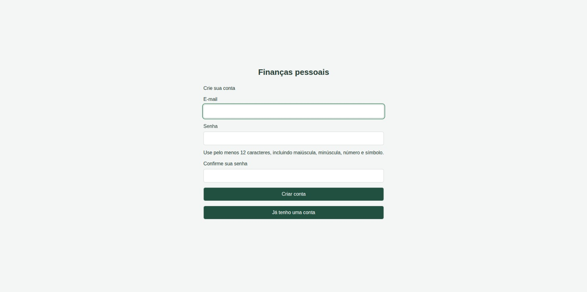
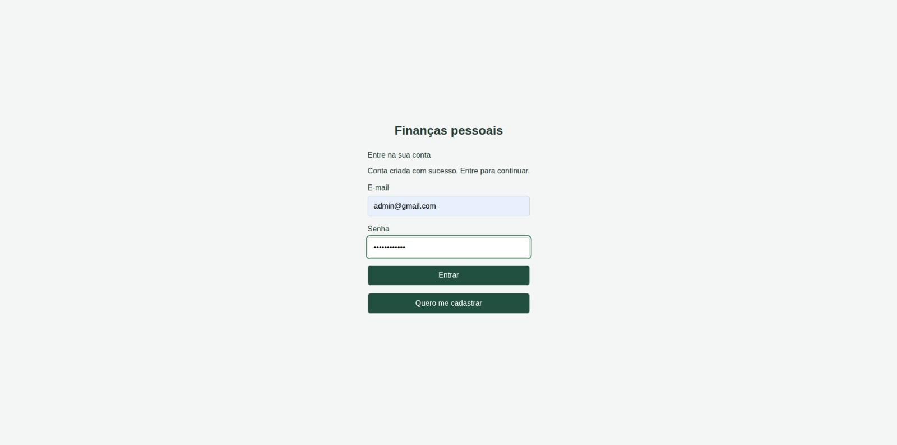
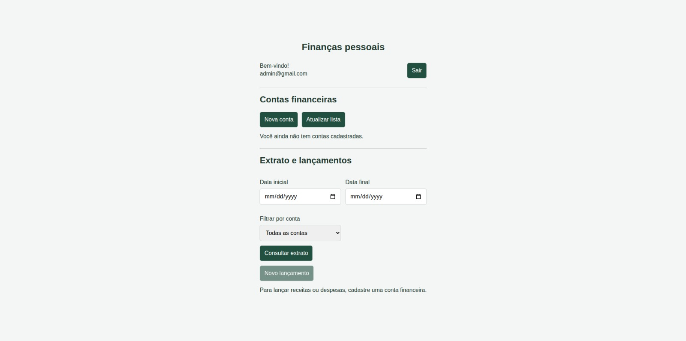
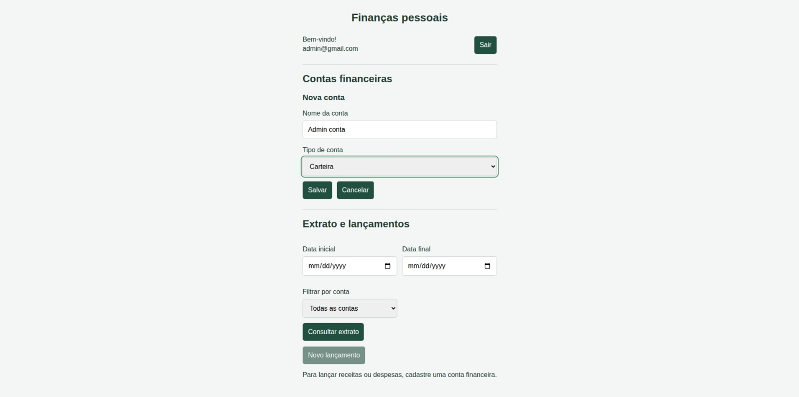
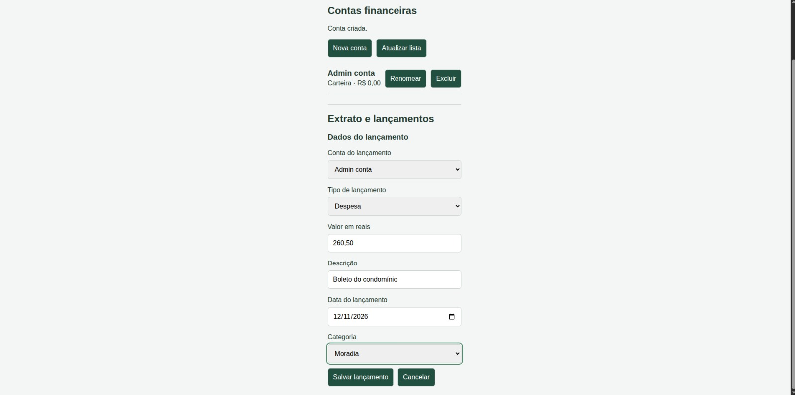
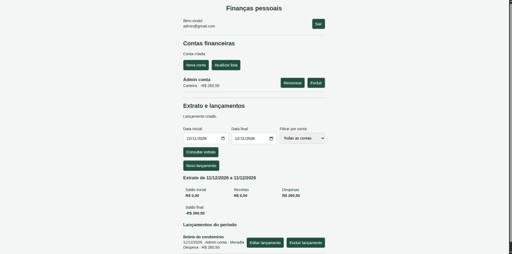

# Gerenciador de Finanças Pessoais

## 1. Identificação

| Nome completo | Matrícula | Turma (14h/16h) | Usuário GitHub |
|---------------|-----------|-----------------|----------------|
| Marjorie Mitzi Cavalcante Rodrigues | 231039140 | 14h | @Marjoriemitzi |
| Samuel Nogueira Caetano | 231027186 | 14h | @samuelncaetano |
| Laryssa Felix Ribeiro Lopes | 231026840 | 14h | @felixlaryssa |
| Arthur Ribeiro e Sousa | 221007850 | 14h | @arthurrsousa |
| Luis Henrique Luz Costa | 180066161 | 14h | @luishenrrique |
| Pedro Henrique Pereira Santos | 232038442 | 14h | @pedrohpsantos |
| Pedro Henrique dos Santos Ferreira | 211063229 | 14h | @pedro-hsf |

- **Nome do projeto:** Gerenciador de Finanças Pessoais
- **Nome do grupo:** Equipe: Gerenciador de finanças pessoais
- **Repositório:** https://github.com/Marjoriemitzi/Trabalho_Paradigmas_2026.2
- **Commit ou tag entregue:** `main`
- **Ponto de partida:** jogo inventado
- **Slides da apresentação oral:** não há

## 2. Resumo

O Gerenciador de Finanças Pessoais é uma aplicação web voltada para usuários que desejam controlar contas, transações, transferências e lançamentos recorrentes em um único lugar, com autenticação segura e isolamento de dados por usuário. A interface web foi construída em Elm seguindo o paradigma funcional, enquanto a API em FastAPI (Python) faz a ponte com o banco PostgreSQL e com o motor lógico em SWI-Prolog. O Prolog resolve de forma declarativa três problemas centrais de regras de negócio: classificação automática de transações por palavras-chave, cálculo de vencimento de recorrências semanais e mensais (incluindo anos bissextos e meses mais curtos) e validação de políticas de senha com geração de múltiplos motivos de erro.

**1. Cadastro de usuário:** tela de criação de conta exibindo os requisitos da política de senha validada no motor Prolog (mínimo de 12 caracteres, maiúscula, minúscula, número e símbolo).



**2. Autenticação:** tela de login após o cadastro, exibindo a confirmação de criação da conta para acesso ao sistema.



**3. Painel inicial:** visão do usuário autenticado antes de cadastrar contas financeiras, com acesso à gestão de contas e aos filtros de extrato.



**4. Cadastro de conta financeira:** formulário para criação de uma nova conta (neste exemplo, uma carteira chamada *Admin conta*).



**5. Registro de lançamento:** após a criação da conta, o usuário preenche uma despesa (*Boleto do condomínio*, R$ 260,50) associada à categoria *Moradia*.



**6. Extrato e saldo atualizados:** confirmação do lançamento criado, com o saldo da conta recalculado automaticamente (-R$ 260,50), resumo do período e opções para editar ou excluir a movimentação.




## 3. Como executar

**Requisitos:**

- Git
- Docker com Docker Compose v2 (sobe automaticamente PostgreSQL, Python 3.12, FastAPI, SWI-Prolog e Frontend em Elm 0.19.1)
- Para execução local fora do Docker: Python 3.12+, Poetry, SWI-Prolog 9.x, Node.js 20+ e Elm 0.19.1

**Instalação e execução:**

```sh
git clone https://github.com/Marjoriemitzi/Trabalho_Paradigmas_2026.2.git
cd Trabalho_Paradigmas_2026.2

# 1. Gerar o arquivo .env com segredos locais
cp .env.example .env && chmod 600 .env
sed -i "s/^POSTGRES_PASSWORD=.*/POSTGRES_PASSWORD=$(openssl rand -hex 32)/; s/^APP_DB_PASSWORD=.*/APP_DB_PASSWORD=$(openssl rand -hex 32)/; s/^JWT_SECRET=.*/JWT_SECRET=$(openssl rand -hex 32)/" .env

# 2. Construir e subir os containers (banco, API com Prolog e frontend Elm)
docker compose build
docker compose up -d
docker compose ps
curl http://127.0.0.1:8000/health
```

**Testes:**

```sh
# Backend (unitários, integração com Prolog/PostgreSQL, contratos e E2E)
docker compose run --rm --no-deps tools task check

# Frontend (testes E2E com Playwright)
cd Frontend && ./test.sh
```

**Testado em:** Linux (Rocky Linux / Ubuntu) e Windows com WSL2, navegador Google Chrome.

## 4. Arquitetura

```
Frontend Elm (0.19.1) --HTTP/JSON (via ports JS)--> Backend FastAPI (Python 3.12) --PySwip--> Regras SWI-Prolog
                                                               |
                                                               v
                                                          PostgreSQL
```

| Parte | Responsabilidade | Arquivos principais |
|-------|------------------|---------------------|
| Prolog | Base de conhecimento e inferência lógica para categorização de transações, recorrências e política de senhas | `Backend/rules/finance/categorization.pl`, `Backend/rules/finance/recurrence.pl`, `Backend/rules/users/password_policy.pl` |
| Elm | Interface web funcional com gerenciamento de estado tipado, telas de autenticação, contas e extrato | `Frontend/src/Main.elm`, `Frontend/src/Accounts.elm`, `Frontend/src/Statement.elm`, `Frontend/src/StatementData.elm`, `Frontend/src/Categories.elm`, `Frontend/src/Api.elm`, `Frontend/src/Money.elm` |
| Python | Camada de API HTTP (FastAPI), persistência em PostgreSQL, autenticação JWT e ponte com SWI-Prolog via PySwip | `Backend/src/app/main.py`, `Backend/src/app/shared/infrastructure/prolog/gateway.py`, `Backend/src/app/finance/`, `Backend/src/app/users/` |

## 5. Parte em Prolog

### 5.1 Predicados principais

| Predicado | Local | O que faz |
|-----------|-------|-----------|
| `transaction_category(+Tipo, +Descricao, -Categoria)` | `Backend/rules/finance/categorization.pl:12` | Classifica uma transação (`expense` ou `income`) buscando palavras-chave na descrição, com fallback para `outros`. |
| `category_choice(+Tipo, -Categoria)` | `Backend/rules/finance/categorization.pl:19` | Enumera por backtracking todas as categorias válidas para um tipo de transação, incluindo `outros`. |
| `recurrence_due(+Frequencia, +Dia, +Ano, +Mes, +DiaDoMes)` | `Backend/rules/finance/recurrence.pl:8` | Verifica se uma data corresponde ao vencimento de uma recorrência semanal (`day_of_the_week/2`) ou mensal (ajustada ao último dia do mês). |
| `last_day(+Ano, +Mes, -Ultimo)` | `Backend/rules/finance/recurrence.pl:14` | Determina o último dia de um mês considerando anos bissextos via `leap_year/1` (`Backend/rules/finance/recurrence.pl:19`). |
| `valid_password(+Senha)` | `Backend/rules/users/password_policy.pl:4` | Valida declarativamente os cinco requisitos da política de senha (tamanho mínimo 12, maiúscula, minúscula, dígito e símbolo). |
| `password_error(+Senha, -Erro)` | `Backend/rules/users/password_policy.pl:11` | Gera via backtracking todos os códigos de erro violados por uma senha (`too_short`, `no_upper`, `no_lower`, `no_digit`, `no_symbol`). |

### 5.2 Conceitos do paradigma lógico utilizados

- [x] Fatos e regras como base de conhecimento: `category_keyword/3` em `Backend/rules/finance/categorization.pl:4` e regras de calendário em `Backend/rules/finance/recurrence.pl:14`.
- [x] Unificação e casamento de padrões: cláusulas separadas por átomo (`weekly`/`monthly`) em `Backend/rules/finance/recurrence.pl:8-10` e por mês em `last_day/3` (`Backend/rules/finance/recurrence.pl:14-17`).
- [x] Recursão (inclusive sobre listas): busca sobre listas de palavras-chave e caracteres usando `member/2` e `memberchk/2` em `Backend/rules/finance/categorization.pl:14`, `Backend/rules/finance/recurrence.pl:16` e `Backend/rules/users/password_policy.pl:26-29`.
- [x] Backtracking e múltiplas soluções: `category_choice/2` (`Backend/rules/finance/categorization.pl:19`) e `password_error/2` (`Backend/rules/users/password_policy.pl:11-20`), que retorna todas as violações de uma senha em uma única consulta.
- [ ] `findall/3`, `bagof/3`, `setof/3` ou similares: não utilizado diretamente nos arquivos `.pl`; a coleta das múltiplas soluções é feita pelo gateway via consultas iteradas no PySwip.
- [x] Corte (`!`) ou negação (`\+`), e por que foram necessários: corte em `transaction_category/3` (`Backend/rules/finance/categorization.pl:16`) para impedir retorno ao fallback `outros` após encontrar uma categoria; cortes em `last_day/3` e `leap_year/1` (`Backend/rules/finance/recurrence.pl:14-19`) para garantir determinismo do calendário; negação por falha `\+` em `password_error/2` e `has_symbol/1` (`Backend/rules/users/password_policy.pl:14-26`) para expressar ausência de classes de caracteres.
- [ ] Programação por restrições (CLP(FD) ou outra): não utilizado.
- [ ] Predicados de ordem superior (`maplist`, `foldl`, `include`, etc.): não utilizado.

### 5.3 Trecho em destaque

Trecho de `Backend/rules/users/password_policy.pl` (linhas 4 a 20):

```prolog
valid_password(Senha) :-
    string_length(Senha, Tamanho), Tamanho >= 12,
    has_upper(Senha),
    has_lower(Senha),
    has_digit(Senha),
    has_symbol(Senha).

password_error(Senha, too_short) :-
    string_length(Senha, Tamanho), Tamanho < 12.
password_error(Senha, no_upper) :-
    \+ has_upper(Senha).
password_error(Senha, no_lower) :-
    \+ has_lower(Senha).
password_error(Senha, no_digit) :-
    \+ has_digit(Senha).
password_error(Senha, no_symbol) :-
    \+ has_symbol(Senha).
```

Esse módulo ilustra bem o estilo declarativo: em vez de acumular erros em um array mutável com uma sequência de `if`s, cada cláusula de `password_error/2` declara independentemente uma condição sob a qual um erro é verdadeiro. Ao consultar `password_error(Senha, Erro)`, o mecanismo de backtracking do Prolog encontra automaticamente todas as violações aplicáveis para explicar ao usuário exatamente o que falta na senha, reutilizando os mesmos predicados auxiliares (`has_upper/1`, `has_lower/1`, `has_digit/1`, `has_symbol/1`) que definem `valid_password/1`.

## 6. Parte em Elm

### 6.1 Modelo e mensagens

Trecho de `Frontend/src/Main.elm` (linhas 20 a 43):

```elm
type alias Model =
    { email : String
    , password : String
    , confirmation : String
    , registering : Bool
    , loading : Bool
    , error : String
    , notice : String
    , user : Maybe User
    , accounts : Maybe Accounts.Model
    , statement : Statement.Model
    }


type Msg
    = ChangeEmail String
    | ChangePassword String
    | ChangeConfirmation String
    | ToggleRegister
    | Submit
    | ReceiveResponse Api.Response
    | AccountsMsg Accounts.Msg
    | StatementMsg Statement.Msg
    | Logout
```

O estado global em `Frontend/src/Main.elm` separa a sessão autenticada do estado deslogado por meio de `user : Maybe User` e `accounts : Maybe Accounts.Model`, evitando representar dados de usuário autenticado com campos vazios ou nulos. Nos submódulos de domínio (`Frontend/src/Accounts.elm`, `Frontend/src/Statement.elm` e `Frontend/src/Categories.elm`), estados de tela e entidades foram modelados com custom types específicos — como `Accounts.Kind` (`Accounts.elm:12`), `Accounts.Listing` (`Accounts.elm:26`), `Accounts.Editor` (`Accounts.elm:32`), `Statement.Listing` (`Statement.elm:29`), `Statement.Catalog` (`Statement.elm:36`), `Statement.Editor` (`Statement.elm:43`) e `Categories.Kind` (`Categories.elm:8`) — para restringir estados inválidos durante carregamento, edição e exibição de dados.

### 6.2 Conceitos do paradigma funcional utilizados

- [x] Arquitetura Elm (Model, update, view): `Frontend/src/Main.elm:20-84`, `Frontend/src/Accounts.elm:39-49` e `Frontend/src/Statement.elm:48-60`.
- [x] Custom types e `case` exaustivo: `Msg` e `update` em `Frontend/src/Main.elm:34-85`, além de `Kind`, `Listing`, `Catalog` e `Editor` em `Frontend/src/Accounts.elm:12-32`, `Frontend/src/Statement.elm:29-43` e `Frontend/src/Categories.elm:8`.
- [x] `Maybe` e `Result` no lugar de null e exceções: `user : Maybe User` e `accounts : Maybe Accounts.Model` em `Frontend/src/Main.elm:28-29`, e decodificação segura de respostas JSON via `Decode.decodeValue`.
- [x] Funções de ordem superior e aplicação parcial: `Decode.map2 User` em `Frontend/src/Main.elm:78` e transformações de listas e mensagens entre módulos (`Cmd.map` / `Html.map`).
- [x] Composição (`|>`, `>>`): encadeamento de transformações de dados e visualização nos módulos `Frontend/src/Statement.elm`, `Frontend/src/Accounts.elm` e `Frontend/src/Money.elm`.
- [x] Decoders e encoders JSON: `userDecoder` em `Frontend/src/Main.elm:76-80` e decoders de contas, categorias e extrato em `Frontend/src/Accounts.elm`, `Frontend/src/Categories.elm` e `Frontend/src/StatementData.elm`.
- [x] Comandos e subscriptions (efeitos controlados): `Browser.element` com `subscriptions = \_ -> Api.responses ReceiveResponse` em `Frontend/src/Main.elm:61-68`, delegando requisições e sessão à fronteira `Frontend/src/Api.elm`.
- [x] Imutabilidade e atualização de records: atualizações puras de estado em `update` (`Frontend/src/Main.elm:86-106`).

### 6.3 Trecho em destaque

Trecho de `Frontend/src/Main.elm` (linhas 61 a 106):

```elm
main : Program Bool Model Msg
main =
    Browser.element
        { init = init
        , update = update
        , view = view
        , subscriptions = \_ -> Api.responses ReceiveResponse
        }


init : Bool -> ( Model, Cmd Msg )
init restoring =
    ( { initialModel | loading = restoring }, Cmd.none )


userDecoder : Decode.Decoder User
userDecoder =
    Decode.map2 User
        (Decode.field "id" Decode.string)
        (Decode.field "email" Decode.string)


update : Msg -> Model -> ( Model, Cmd Msg )
update msg model =
    case msg of
        ChangeEmail email ->
            ( { model | email = email, error = "" }, Cmd.none )

        ChangePassword password ->
            ( { model | password = password, error = "" }, Cmd.none )

        ChangeConfirmation confirmation ->
            ( { model | confirmation = confirmation, error = "" }
            , Cmd.none
            )

        ToggleRegister ->
            ( { model
                | registering = not model.registering
                , password = ""
                , confirmation = ""
                , error = ""
                , notice = ""
              }
            , Cmd.none
            )
```

Esse trecho mostra o controle explícito de efeitos da Arquitetura Elm: toda comunicação externa entra pelo canal tipado `Api.responses ReceiveResponse` via `subscriptions`, os dados recebidos são validados antes de entrarem no modelo por decoders como `userDecoder`, e cada transição de estado em `update` devolve um novo `Model` imutável sem efeitos colaterais ocultos.

## 7. Integração

A comunicação entre o frontend em Elm (`Frontend/src/Api.elm` + `Frontend/public/bootstrap.js`) e o backend em FastAPI ocorre via HTTP/JSON sob a API v1. O backend consulta o SWI-Prolog por meio do gateway `Backend/src/app/shared/infrastructure/prolog/gateway.py` (usando PySwip).

| Rota / chamada | Entrada | Saída | Predicado Prolog |
|----------------|---------|-------|------------------|
| `POST` registro e alteração de senha (`Backend/src/app/users/presentation/api/v1/routers/users.py:41,83`) | JSON com e-mail e senha (ou senha atual e nova) | Usuário criado/atualizado ou lista de erros de política de senha | `valid_password/1` e `password_error/2` (`password_policy.pl`) |
| `POST` login, refresh e logout (`Backend/src/app/users/presentation/api/v1/routers/auth.py:33,53,75`) | Credenciais ou token de refresh | Tokens JWT e controle de sessão | Nenhum (persistência e JWT em Python) |
| `GET` categorias (`Backend/src/app/finance/presentation/api/v1/routers/categories.py:18`) | Tipo opcional (`expense`/`income`) | Lista de categorias disponíveis | `category_choice/2` (`categorization.pl`) |
| `POST / GET / PUT / DELETE` transações (`Backend/src/app/finance/presentation/api/v1/routers/transactions.py:35-112`) | Conta, valor, tipo, data e descrição | Transação registrada com categoria inferida ou extrato | `transaction_category/3` (`categorization.pl`) |
| `POST / GET / PATCH / DELETE` contas (`Backend/src/app/finance/presentation/api/v1/routers/accounts.py:30-93`) | Nome e tipo da conta | Lista ou detalhes das contas | Nenhum (persistência PostgreSQL) |
| `POST / GET / PUT / DELETE` recorrências e CLI `run_due_recurrences` (`Backend/src/app/finance/presentation/api/v1/routers/recurrences.py:29-99`) | Frequência, dia-alvo, intervalo ativo e valor | Regra cadastrada e lançamentos gerados nas datas devidas | `recurrence_due/5` (`recurrence.pl`) |
| `POST / GET / PUT / DELETE` transferências (`Backend/src/app/finance/presentation/api/v1/routers/transfers.py:31-96`) | Conta origem, conta destino, valor e data | Transferência registrada entre contas | Nenhum (persistência PostgreSQL) |

## 8. Testes e validação

- **Testes de integração com Prolog (`pytest`):** validam diretamente os três módulos `.pl` através do gateway (`Backend/tests/finance/integration/test_prolog_categorizer.py`, `Backend/tests/finance/integration/test_recurrence_rules.py`, `Backend/tests/users/integration/test_prolog_password_policy.py` e `Backend/tests/shared/integration/test_prolog_gateway.py`).
- **Testes unitários, de propriedades, de contrato e E2E do backend (`pytest`):** cobrem domínio financeiro e de usuários, isolamento entre usuários (`test_tenant_isolation_real.py`), contrato OpenAPI (`test_openapi_contract.py`), migrações Alembic, rate-limit de autenticação, refresh/revogação de tokens e execução de recorrências.
- **Testes E2E do frontend (`Playwright`):** validam fluxos completos de autenticação (`Frontend/tests/auth.spec.cjs`), gestão de contas (`Frontend/tests/accounts.spec.cjs`) e extrato (`Frontend/tests/statement.spec.cjs`).
- **CI automatizado:** workflow `.github/workflows/backend.yml` executa migrações (`alembic upgrade/downgrade`), formatação (`ruff`), checagem de tipos (`mypy`), `pytest` e auditoria de dependências (`pip-audit`) a cada PR e push na `main`.
- **Casos de borda verificados:** recorrências mensais no dia 29, 30 ou 31 em meses curtos e anos bissextos/não bissextos; descrições sem palavra-chave caindo em `outros`; senhas com múltiplas violações simultâneas; isolamento estrito de contas e extratos entre usuários diferentes; bloqueio de tentativas excessivas de login e rotação/revogação de refresh tokens.

## 9. Limitações e problemas conhecidos

- **Complexidade da integração entre partes:** o maior desafio técnico do projeto foi integrar todas as camadas — frontend em Elm (com ports JavaScript), API FastAPI, banco PostgreSQL, migrações, autenticação com refresh token e o motor SWI-Prolog — garantindo que todos os serviços subissem e se comunicassem de forma consistente via Docker.
- **Interface de recorrências e recursos avançados no frontend:** embora o backend já possua suporte completo e testado para recorrências e transferências, nem todos os fluxos secundários possuem cobertura visual equivalente na interface Elm.
- **Testes Prolog isolados (`plunit`):** os testes das regras Prolog estão integrados na suíte `pytest` via PySwip; com mais tempo, o grupo adicionaria suítes `plunit` nativas executáveis diretamente pelo `swipl` e ampliaria a base de regras lógicas (como alertas de orçamento e sugestões de metas).
- **Proporção de código Python:** como o sistema inclui autenticação completa, migrações e persistência relacional em PostgreSQL, a camada de infraestrutura em Python ficou extensa em relação aos arquivos `.pl`.

## 10. Contribuição de cada integrante

| Integrante | Principais contribuições |
|------------|--------------------------|
| Samuel Nogueira Caetano | Desenvolvimento do backend (arquitetura da API em FastAPI, integração com PostgreSQL e SWI-Prolog, regras de domínio e CI). |
| Marjorie Mitzi Cavalcante Rodrigues | Desenvolvimento do backend (funcionalidades de autenticação/sessão, endpoints da API, documentação e organização da entrega). |
| Laryssa Felix Ribeiro Lopes | Desenvolvimento do backend (apoio na implementação de rotas, regras de negócio e revisão de código). |
| Arthur Ribeiro e Sousa | Desenvolvimento do frontend em Elm (módulos de interface, integração com a API e fluxos de contas e extrato). |
| Luis Henrique Luz Costa | Desenvolvimento do frontend em Elm (componentes de interface, estilização e integração com o backend). |
| Pedro Henrique Pereira Santos | Testes automatizados (criação e execução de testes unitários, de integração e E2E) e revisão de qualidade. |
| Pedro Henrique dos Santos Ferreira | Testes automatizados, validação dos fluxos do sistema e apoio na verificação de bugs. |

## 11. Fontes, código de terceiros e uso de IA

**Código reaproveitado.** O projeto foi desenvolvido do zero pelo grupo para o domínio de finanças pessoais, sem partir do código do template de Sudoku. Apenas os arquivos de estrutura de entrega (`RELATORIO.md`, `AVALIACAO.md` e `Makefile`) seguiram o modelo fornecido pela disciplina.

**Referências.** Documentação oficial do SWI-Prolog, documentação oficial do Elm 0.19.1 (`guide.elm-lang.org`), documentação do FastAPI, SQLAlchemy, Alembic, PySwip, Playwright e materiais de aula da disciplina `fabiommendes/paradigmas-2026-2`.

**Uso de ferramentas de IA.**

- **Faixa de uso no código:** auxiliar

| Ferramenta | Para que foi usada | Como o grupo verificou o resultado |
|------------|--------------------|------------------------------------|
| ChatGPT | Brainstorming de ideias de arquitetura/funcionalidades e apoio na investigação e resolução de bugs | Revisão manual obrigatória por outro integrante do grupo via Pull Requests no GitHub e execução dos testes automatizados |
| Gemini | Tirar dúvidas técnicas, sugestões de estruturação e auxílio na depuração de erros | Revisão manual obrigatória por outro integrante via Pull Requests e validação pelo pipeline de CI |
| Claude | Sugestões de soluções para problemas de integração e auxílio na depuração de bugs | Revisão manual obrigatória por outro integrante via Pull Requests e checagem com `ruff`, `mypy` e `pytest` |
| GitHub Copilot | Sugestões pontuais de autocompletar e apoio durante a depuração no editor | Revisão de código em Pull Requests por pares e validação nos testes unitários, de integração e E2E |

## 12. Apresentação oral

- **Slides:** não há
- **Roteiro:**

| Parte | Duração | Quem apresenta |
|-------|:-------:|----------------|
| Contexto, objetivo e arquitetura geral | 2 min | Marjorie Mitzi Cavalcante Rodrigues |
| Demonstração do sistema funcionando | 4 min | Arthur Ribeiro e Sousa e Luis Henrique Luz Costa |
| Código Prolog (regras e integração) | 3 min | Samuel Nogueira Caetano e Laryssa Felix Ribeiro Lopes |
| Código Elm (tipos, arquitetura e estado) | 3 min | Arthur Ribeiro e Sousa e Luis Henrique Luz Costa |
| Testes, limitações e aprendizados | 3 min | Pedro Henrique Pereira Santos e Pedro Henrique dos Santos Ferreira |

## 13. Reflexão sobre os paradigmas

Trabalhar com Prolog tornou mais simples e direto expressar regras de negócio declarativas, como a classificação de transações por palavras-chave, a política de senhas que devolve múltiplas violações por backtracking e as regras de calendário para recorrências. Em vez de escrever fluxos imperativos cheios de desvios condicionais e listas temporárias de erro, bastou declarar as relações verdadeiras e deixar o motor de inferência buscar as soluções. Por outro lado, o aspecto mais difícil foi integrar o SWI-Prolog ao restante de uma aplicação web concorrente com tipagem estrita e banco relacional, além de exigir cuidado com o uso de cortes (`!`) e negação por falha (`\+`).

No frontend, o compilador do Elm impediu que erros comuns de JavaScript chegassem à execução: estados incompletos de interface, campos ausentes em respostas JSON e casos não tratados no `update` eram bloqueados em tempo de compilação. A exigência de modelar explicitamente `Maybe`, decoders e custom types guiou a organização dos módulos (`Accounts`, `Statement`, `Categories`) e reduziu regressões durante a integração com a API.

Alternar entre os dois paradigmas mudou a forma de projetar o sistema: em Prolog, o foco foi descrever "o quê" torna uma regra válida por meio de relações e unificação; em Elm, o foco foi desenhar tipos fechados e funções puras em que cada transição de estado é previsível e verificada pelo compilador.